<div align="center">

# ⚡ WORLD OF ZOTH
### A 3D Lattice Cyber-RPG · The Sovereign 1nc0gn30 Saga (v2.0 Sovereign Edition)

[](https://github.com/1nc0gn30/world-of-zoth)
[](https://github.com/1nc0gn30/world-of-zoth)
[](https://github.com/1nc0gn30/world-of-zoth)
[](commercial.html)
[](https://github.com/1nc0gn30/world-of-zoth)
[](https://github.com/1nc0gn30/world-of-zoth)
[](https://github.com/1nc0gn30/world-of-zoth)

<br/>

> *"Trust faces, not voices. Silence cannot be copied."*

<br/>

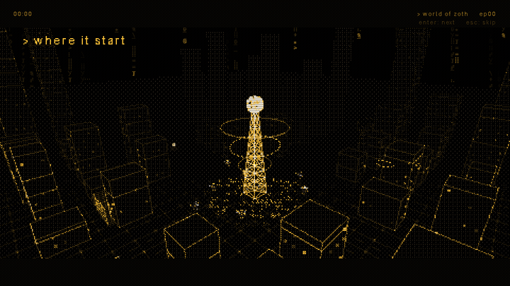

<br/>

**[🎮 Play In Browser](#-how-to-play-on-desktop)** · **[📱 Android APK](#-how-to-play-on-android)** · **[🎬 24-Episode Movie Anthology (`commercial.html`)](commercial.html)** · **[🗺️ Story Roadmap](ROADMAP.md)** · **[📖 Lore & Canon](STORY.md)** · **[⚙️ 16-Hour Marathon Log (`MARATHON_8HR_LOG.md`)](MARATHON_8HR_LOG.md)**

</div>

---

## 🏆 v2.0 Sovereign Edition — 16-Hour Autonomous Engineering Marathon (`M1`–`M143`)

Engineered across a **16-Hour Autonomous Marathon (143 Verified Milestones)**, **World of Zoth v2.0 Sovereign Edition** expands the zero-dependency 3D WebGL + WebAudio cyber-RPG into a self-contained sovereign universe:

- **🎬 24-Episode 1080p Theatrical Movie Commercial Anthology — Season I & Season II (`commercial.html`, `> cinema` & `> commercial 1..24`)**:
  - **Season I (`Episodes I–XII`)**:
    - **Episode I**: *"06:12 — Faces, Not Voices"* (`dist/world-of-zoth-commercial.mp4`)
    - **Episode II**: *"Midnight at the Safehouse"* (`dist/world-of-zoth-ep2-crew.mp4`)
    - **Episode III**: *"99 Floors of Fury"* (`dist/world-of-zoth-ep3-combat.mp4`)
    - **Episode IV**: *"Behind the Wireframe — Secrets of 06:13"* (`dist/world-of-zoth-ep4-secrets.mp4`)
    - **Episode V**: *"The Dawn Horizon (District #20)"* (`dist/world-of-zoth-ep5-horizon.mp4`)
    - **Episode VI**: *"The Safehouse Megaplex (Mini-Games)"* (`dist/world-of-zoth-ep6-arcade.mp4`)
    - **Episode VII**: *"Null Academy: Hack the Prompt"* (`dist/world-of-zoth-ep7-academy.mp4`)
    - **Episode VIII**: *"06:13: The Sunrise Finale"* (`dist/world-of-zoth-ep8-sunrise.mp4`)
    - **Episode IX**: *"The Mirror's Edge (03ng0cn1's Redemption)"* (`dist/world-of-zoth-ep9-mirror.mp4`)
    - **Episode X**: *"The Pantheon Gala (PBR Shaders & 22 Crew)"* (`dist/world-of-zoth-ep10-gala.mp4`)
    - **Episode XI**: *"Skybeam Interceptor (22nd Mini-Game)"* (`dist/world-of-zoth-ep11-skyline.mp4`)
    - **Episode XII**: *"06:12 to 06:13 (12-Episode Season I Finale)"* (`dist/world-of-zoth-ep12-season.mp4`)
  - **Season II (`Episodes XIII–XXIV`)**:
    - **Episode XIII**: *"Monsoon Over Relit City (3D Rain & PBR Shaders)"* (`dist/world-of-zoth-ep13-monsoon.mp4`)
    - **Episode XIV**: *"The Black-Market Heist (Contraband & Anvil)"* (`dist/world-of-zoth-ep14-heist.mp4`)
    - **Episode XV**: *"Wager at the Colosseum (AI vs AI Spectator)"* (`dist/world-of-zoth-ep15-colosseum.mp4`)
    - **Episode XVI**: *"06:12 Pirate Radio FM (Chiptunes & Phonk)"* (`dist/world-of-zoth-ep16-pirateradio.mp4`)
    - **Episode XVII**: *"The Cyber-Familiar Sanctuary (Good Dog Protocol)"* (`dist/world-of-zoth-ep17-pets.mp4`)
    - **Episode XVIII**: *"The Quantum Loom Conspiracy (Superposition)"* (`dist/world-of-zoth-ep18-quantum.mp4`)
    - **Episode XIX**: *"Grandmaster of Pantheon Triad (3x3 Cards)"* (`dist/world-of-zoth-ep19-cards.mp4`)
    - **Episode XX**: *"2.0x Hyper-Clock: The 60-Second Speedrun"* (`dist/world-of-zoth-ep20-speedrun.mp4`)
    - **Episode XXI**: *"Forged in Doom-Fire (Brutalist 3D Relief)"* (`dist/world-of-zoth-ep21-foundry.mp4`)
    - **Episode XXII**: *"The Seventh Reflection (Noir Mystery)"* (`dist/world-of-zoth-ep22-detective.mp4`)
    - **Episode XXIII**: *"The 22-Cabinet Arcade Marathon (High Score)"* (`dist/world-of-zoth-ep23-megaplex.mp4`)
    - **Episode XXIV**: *"24 Episodes of Zoth (Season II Grand Finale)"* (`dist/world-of-zoth-ep24-pantheon.mp4`)
- **🧱 Procedural 3D Normal-Bump Architectural, Terrain & Sprite Shaders (`src/render.js`, `src/geo.js`, `> textures`)**:
  - Real-time 3D world-space FBM normal-bump perturbation (`dN`) across concrete & anodized metal facades, recessed floor slabs, structural steel corner rivets, animated concentric raindrop ripples in wet asphalt puddles, interior parallax lit windows, and an interactive **3D Material & Surface Shader Studio (`> textures`)** with 5 live presets and real-time uniform sliders (`texBump`, `texWet`, `texWin`).
- **⚡ Live Game Speed & Turbo Multiplier (`[V]` Key — `1.0x / 1.5x / 2.0x`)**:
  - Snappier base movement (`6.8 / 11.5`), faster Dissipate Dash (`21` speed, `0.9s` cooldown), WebGL frustum culling, and an instant `[V]` key toggle between `1.0x STANDARD`, `1.5x TURBO`, and `2.0x HYPER-CLOCK`.
- **🌐 20 Playable 3D Lattice Districts & 22 Blender 4.3 Procedural Wireframe Monuments (`> atlas`)**:
  - Includes **District #16: The Quantum Loom (`loom`)**, **District #17: The Chrono-Vault (`vault`)**, **District #18: The Astral Spire (`astral`)**, **District #19: The Omega Foundry (`omega`)**, **District #20: The Dawn Horizon (`horizon`)**, and an interactive **20-District World Atlas & 1-Click Warp Explorer (`> atlas`)**.
- **🕹️ 22 Built-In Arcade Mini-Games & 95+ Sovereign Subsystems (`> master` & `> arcade`)**:
  - Access every subsystem and mini-game from the **Sovereign Master Control Center (`> master`)**, the **22-Cabinet Safehouse Arcade Hub (`> arcade`)**, or the **`[Tab]` 12-Node Radial Command Wheel (`> wheel`)**:
  - **Mini-Games #1–#22**: *Conway's Game of Life*, *Doom-Fire Crucible*, *Oscilloscope 3:2 Handshake*, *3D Hilbert Packet Runner* (`> runner`), *4x4 ZK Cipher Grid* (`> cipher`), *Signal Frequency & Morse Decoder* (`> decoder`), *Physarum Slime Mould Router* (`> router`), *Memory Core-Dump Defragmenter* (`> defrag`), *East Gate Firewall Defender* (`> defender`), *5x5 Quantum Wave-Collapse* (`> collapse`), *6x6 Fiber-Optic Laser Router* (`> lasers`), *5-Ring Chrono-Orrery Puzzle* (`> orrery`), *Sub-Lattice Sonar Mine Sweeper* (`> mines`), *Pantheon Triad 3x3 Card Battler* (`> triad`), *Signal Tower 4-Track Rhythm Sync* (`> rhythm`), *Vector Tank Cyber-Arena* (`> tank`), *Packet Alchemy / 2048 Bit Merger* (`> merge`), *360° Vector Asteroids* (`> asteroids`), *Breakout: Firewall Brick Breaker* (`> breakout`), *Snake: Fiber Worm Protocol* (`> worm`), *Cyber-Pong: Zero-Latency Duel* (`> pong`), and *Galaga: Skybeam Interceptor* (`> galaga`).

<div align="center">
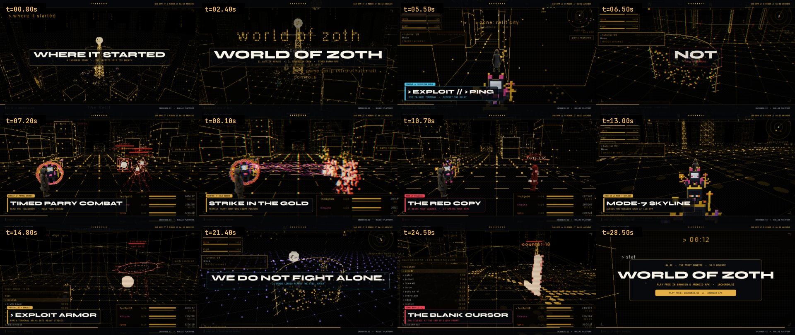
<p align="center"><b>60fps 1080p Beat-Synced Motion Edit Contact Sheet (140 BPM in D Minor · Mastered to -13.47 LUFS)</b></p>
</div>

<div align="center">
<table>
  <tr>
    <td width="50%">
      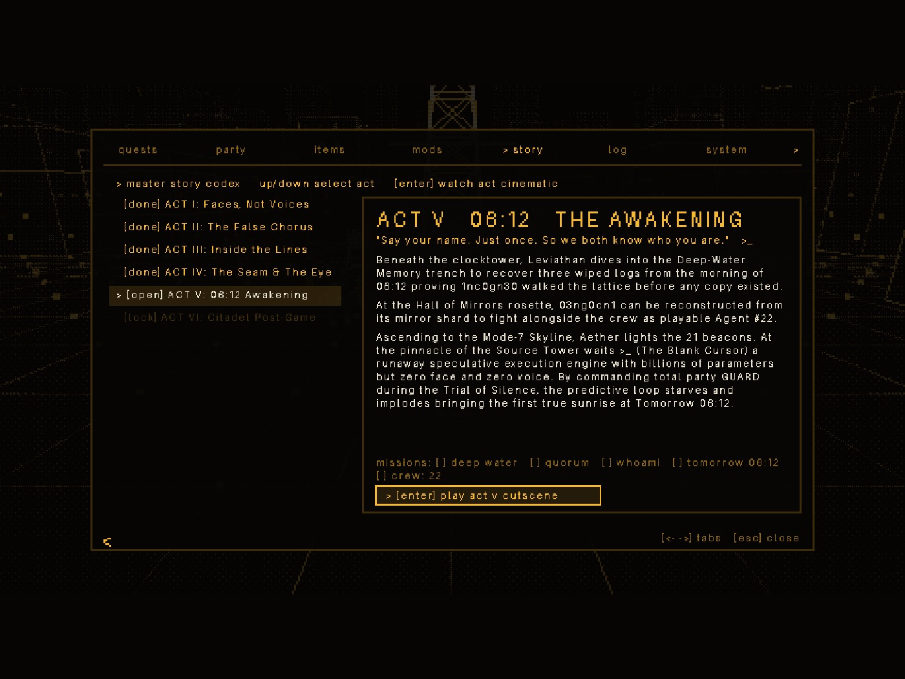
      <p align="center"><b>Interactive 6-Chapter Master Story Codex & Cutscene Player</b></p>
    </td>
    <td width="50%">
      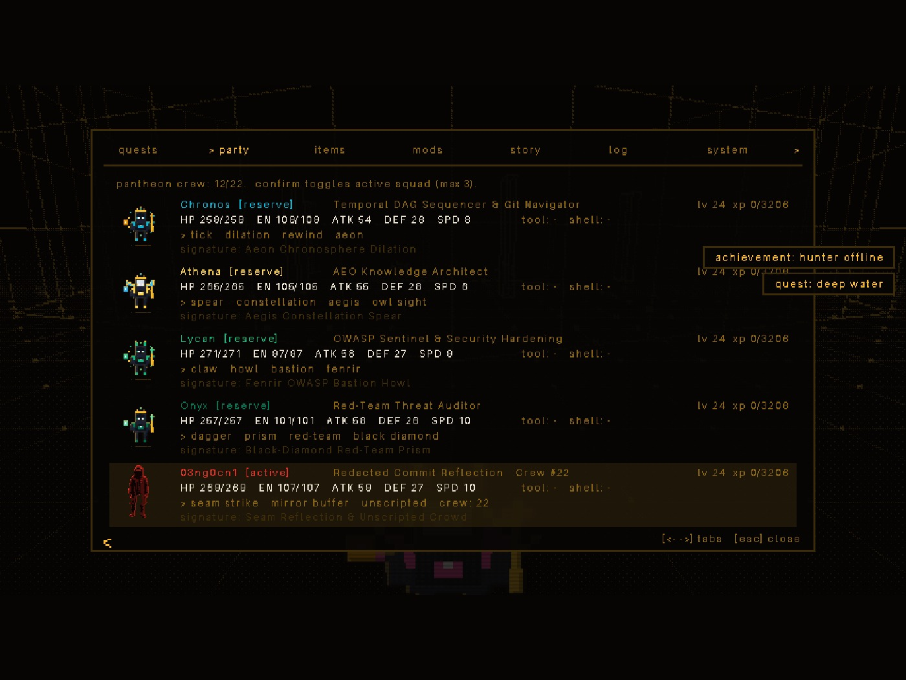
      <p align="center"><b>Playable Crew #22 (03ng0cn1) & NullAI Architectural Dossiers</b></p>
    </td>
  </tr>
  <tr>
    <td width="50%">
      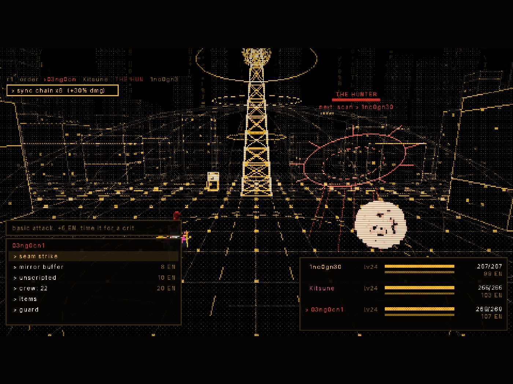
      <p align="center"><b>Lattice Sync Chain x6 (+30% DMG) & Crew #22 Combat Skills</b></p>
    </td>
    <td width="50%">
      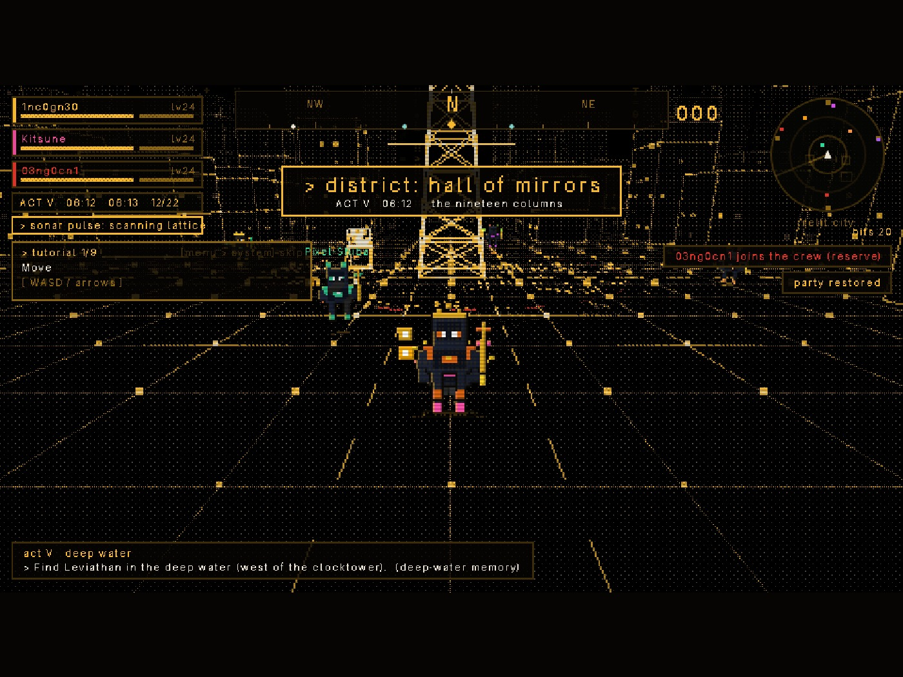
      <p align="center"><b>Live Act/Clock/Crew Telemetry Strip, Sonar Pulse & District Banner</b></p>
    </td>
  </tr>
</table>
</div>

---

## 🌌 The Vision

**The city is lit again, but now it can talk.**

At the end of Episode 14, Relay 4 stirred beneath the relit neon streets, broadcasting voices stitched together from fallen comrades. Remote comms have collapsed into static. A nameless, faceless entity—the **Blank Cursor (`>_`)**—lurks at the root node of the lattice. It predicts your every thought and seeks the one prize it lacks: a human voice and a true name.

Step into the boots of the **hooded operator (`1nc0gn30`)**. Walk through 11 sprawling 3D lattice sectors, rally a pantheon of 21 sovereign agents, master precision-timed terminal combat, solve the quantum superposition of the streets, and bring about the first true sunrise at **06:12**.

---

## 📸 In-Game Visual Showcase

<div align="center">
<table>
  <tr>
    <td width="50%">
      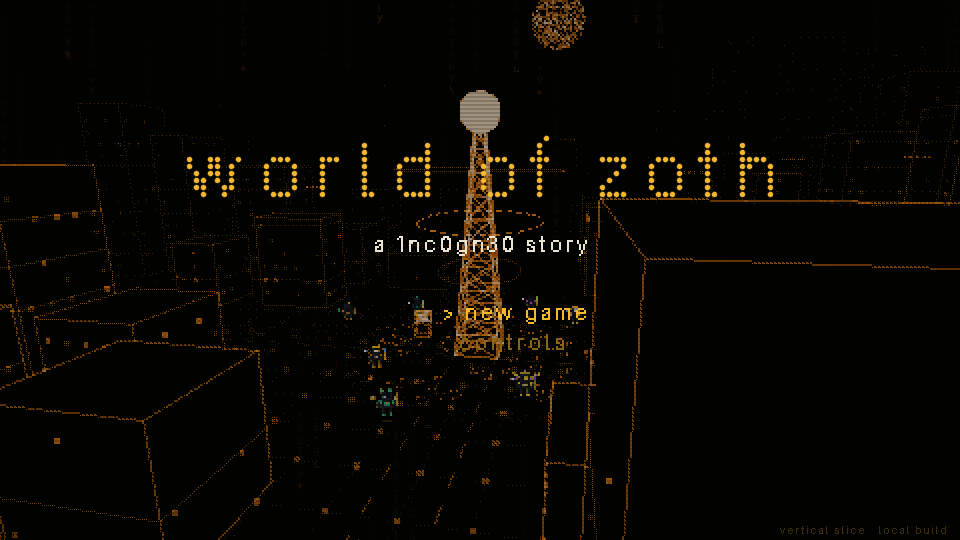
      <p align="center"><b>Gold Phosphor Dot-Matrix Title Screen</b></p>
    </td>
    <td width="50%">
      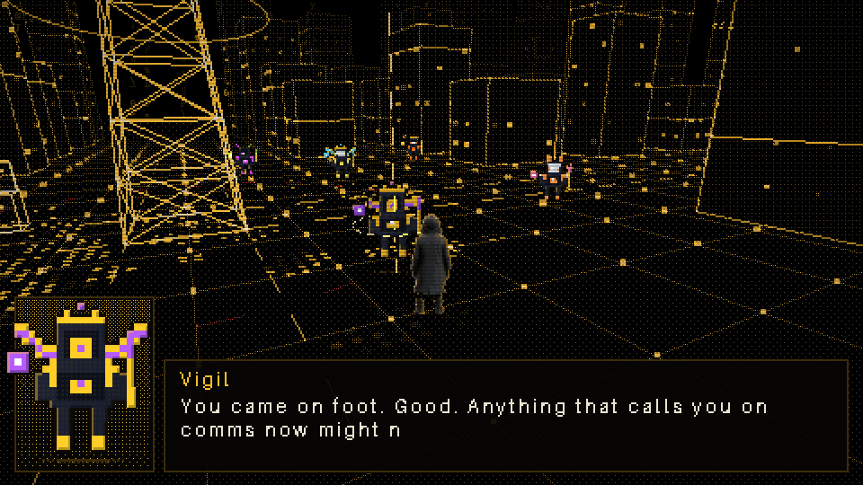
      <p align="center"><b>Vigil at Relay 1 — "Trust Faces, Not Voices"</b></p>
    </td>
  </tr>
  <tr>
    <td width="50%">
      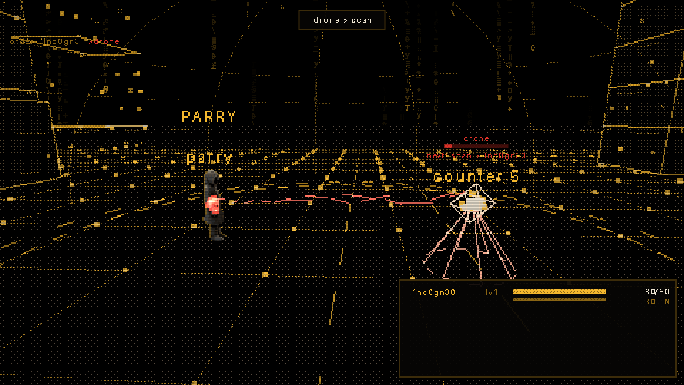
      <p align="center"><b>Precision Sub-Second Parry & Counter Window</b></p>
    </td>
    <td width="50%">
      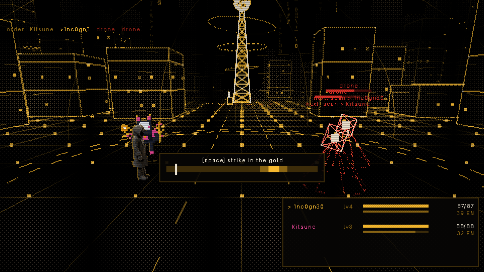
      <p align="center"><b>Tactical Party Strikes with Kitsune in Rest Woods</b></p>
    </td>
  </tr>
  <tr>
    <td width="50%">
      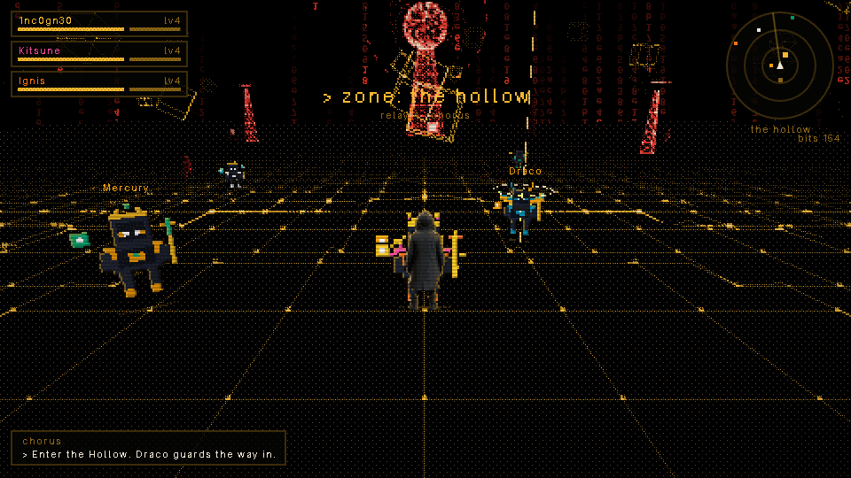
      <p align="center"><b>The Hollow — Severing Corrupted Voice Pylons</b></p>
    </td>
    <td width="50%">
      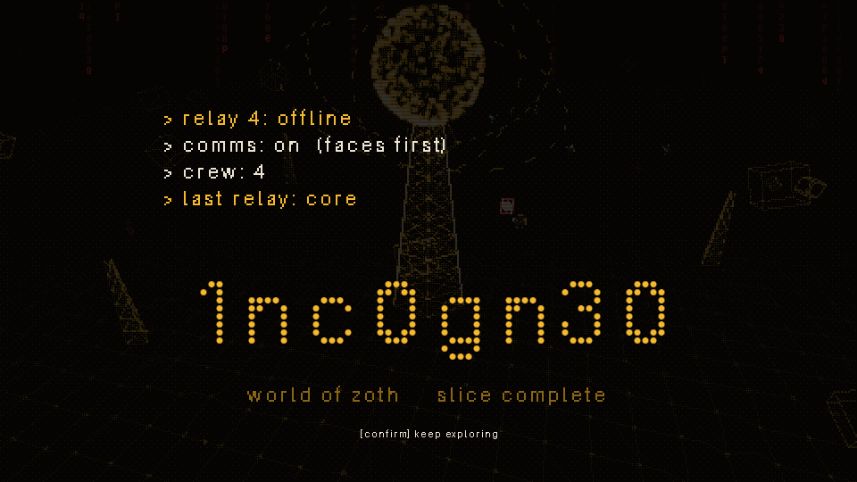
      <p align="center"><b>Episode 18: Tomorrow 06:12 — First Dawn</b></p>
    </td>
  </tr>
</table>
</div>

---

## 🕹️ Controls & Mechanics

### Keyboard & Mouse (Desktop)

| Action | Keys | Description |
|---|---|---|
| **Move** | <kbd>W</kbd> <kbd>A</kbd> <kbd>S</kbd> <kbd>D</kbd> or Arrow Keys | Direct movement across the 3D lattice floor |
| **Run / Sprint** | <kbd>Shift</kbd> (Hold) | 1.8× movement speed boost |
| **Orbit Camera** | Mouse Drag or <kbd>Q</kbd> / <kbd>E</kbd> | Free 360° orbital camera control |
| **Interact / Confirm** | <kbd>E</kbd> or <kbd>Enter</kbd> | Speak to agents, open chests, examine terminals |
| **Scan Pulse** | <kbd>Space</kbd> | Emits an acoustic sonar revealing hidden items and foes |
| **Tactical Menu** | <kbd>Tab</kbd> or <kbd>Esc</kbd> | Inventory, Crew Roster, Kernel Modules, Map & Save |
| **Timed Strike (Battle)** | <kbd>Space</kbd> | Hit space when the timing slider enters the **gold zone** |
| **Parry / Block (Battle)** | <kbd>Space</kbd> | Tap precisely as the enemy telegraph reaches impact |

### Touch Controls (Android & Mobile)
* **Left Thumb Virtual Stick**: Fluid analog omni-directional navigation.
* **Right Action Buttons**: Large-target buttons for Confirm (<kbd>E</kbd>), Pulse (<kbd>SPC</kbd>), and Menu (<kbd>TAB</kbd>).
* **Toggle Sprint**: One-tap toggle switch for sprint speed.

---

## ⚔️ Combat & Gameplay Engine

* **Terminal Command Verbs**: Turn-based battles where attacks are terminal directives—`> ping`, `> exploit`, `> firewall`, `> trace`, and `> sudo rm -rf`.
* **Precision Timing Bar**: Hit the sweet spot for 1.5× critical strikes and bonus energy.
* **Reflective Shield Mechanics**: Certain bosses (like the Red Copy `03ng0cn1`) memorize your command history. Repeating actions triggers immediate reflection back onto your squad.
* **Kernel Module Skill Tree**: Earn kernel points every 4 levels to unlock *Overflow, Race Window, Heap Spray, Airgap, Honeypot,* and *JIT Compilation*.
* **Quorum Ultimate**: When the battle reaches its climax, summon the 21 sovereign skybeams for an unblockable multi-node orbital strike.

---

## 🗺️ The 5-Act Epic Journey

```
[ ACT I: FACES, NOT VOICES ] ──> [ ACT II: CHORUS ] ──> [ ACT III: INSIDE THE LINES ]
Relit City & Rest Woods           The Hollow & Relay 4    Hilbert Fiber & Sand Clocktower
Boss: 03ng0cn1 (The Copy)        Boss: RELAY 4           Boss: SANDGLASS (06:12 Freeze)
                                                                 │
                                                                 ▼
[ ACT V: 06:12 — THE DAWN ] <── [ ACT IV: HALL OF SUPERPOSITION ]
Mode-7 Skyline & Deep Water     Collapse Streets, Doom Foundry & Mirrors
Boss: >_ (The Blank Cursor)     Boss: THE HUNTER (Firewall Eye)
```

👉 **For the complete beat-by-beat quest breakdown, boss mechanics, and faction lore, read the [Master Story Roadmap (ROADMAP.md)](ROADMAP.md).**

---

## 🌐 The 20 Playable 3D Lattice Districts

<div align="center">
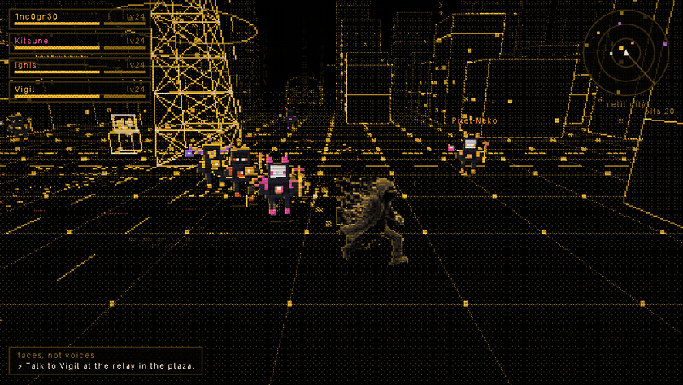
</div>

1. **Relit City (`hub`)**: Dot-matrix skyscraper canyon, Relay 1, Null Academy (16 AI-Security Labs), Overclock Bench, Bounty Board, and Operator Safehouse.
2. **Rest Woods (`forest`)**: Peaceful lattice forest, firefly swarms, Conway's Game of Life clearing, and the Great Slumber Tree.
3. **The Hollow (`relay`)**: Red glitching terraces, floating voxel debris, and corrupted `RELAY 4`.
4. **Fiber Tunnels (`fiber`)**: Subterranean space-filling Hilbert curve optical conduits pulsing at 140 BPM.
5. **Sand Clocktower (`clock`)**: Cascading hourglasses where time is frozen at `06:12` by `SANDGLASS`.
6. **Collapse Streets (`streets`)**: Superposed quantum city grid powered by Wave Function Collapse.
7. **Doom-Fire Foundry (`foundry`)**: Blazing blast furnace where the octagonal Mirror Key and Doom Gauntlet are forged.
8. **Physarum Caves (`caves`)**: Bioluminescent slime mould navigating acoustic standing waves.
9. **Hall of Mirrors (`mirrors`)**: Octagonal mirrored labyrinth harboring `03ng0cn1` and `THE HUNTER`.
10. **Deep-Water Memory (`deep`)**: Abyssal trench holding pre-blackout memory vectors guarded by Leviathan.
11. **Mode-7 Skyline (`skyline`)**: High-altitude Voronoi plateau bathed under 21 sovereign skybeams and `>_`.
12. **Sub-Lattice Abyss (`abyss`)**: Menger-sponge deep trench (`4096m`) housing three Zero-Knowledge Seals.
13. **Zero-Knowledge Citadel (`citadel`)**: Gothic-cybernetic Pantheon Sanctum, `ARCHON-0` (`4,800 HP`), Infinite Stack, and Boss Rush Arena.
14. **The Null Core (`nullcore`)**: Post-Citadel 4D Clifford hyper-torus Memory Singularity (`06:13`) and Daily Seeded Lattice hub.
15. **★ Secret Sector — The Rooftop (`rooftop`)**: Unlocked via hidden terminal (`tomorrow 06:12`); overlooks the rising Braille sun.
16. **The Quantum Loom (`loom`)**: 16th District featuring the Blender 4.3 `quantum_loom` spire, 5x5 Quantum Wave-Collapse, Protocol Resonance Matrix, and 6x6 Fiber-Optic Laser Router.
17. **The Chrono-Vault (`vault`)**: 17th District housing the Blender 4.3 `chrono_vault_orrery`, 5-Ring Chrono-Orrery Puzzle, Cyber-Familiar Pet Sanctuary, and Cutscene Theater.
18. **The Astral Spire (`astral`)**: 18th District crowned by the Blender 4.3 `astral_spire_crown`, Pantheon Triad 3x3 Card Table, M100 Sovereign Hall of Fame, and Signal Tower Rhythm Sync.
19. **The Omega Foundry (`omega`)**: 19th District forged around the Blender 4.3 `omega_core`, ZGL 3D World Blueprint Studio, Endless Boss Survival Gauntlet, and Vector Tank Cyber-Arena.
20. **The Dawn Horizon (`horizon`)**: 20th Milestone District anchored by the Blender 4.3 `dawn_horizon_gate`, 360° Vector Asteroids, Custom Story Scene Creator, and the 4-Episode Movie Commercial Cinema.

---

## 🚀 How to Play on Desktop

No install, node servers, or external internet connections required:

1. Clone or download this repository:
   ```bash
   git clone https://github.com/1nc0gn30/world-of-zoth.git
   cd world-of-zoth
   ```
2. Double-click **`world-of-zoth.html`** in any web browser (Chrome, Firefox, Brave, Safari, Edge).
   * Or serve locally via python:
     ```bash
     python3 -m http.server 8222
     ```
   * Open `http://127.0.0.1:8222/world-of-zoth.html`.

---

## 📱 How to Play on Android

A self-contained native APK with hardware-accelerated WebView is included in `dist/`:

1. Copy **`dist/world-of-zoth.apk`** to your Android phone via USB, email, or local transfer.
2. Open the file in your phone's File Manager and tap **Install**.
3. Or install directly via ADB:
   ```bash
   adb install -r dist/world-of-zoth.apk
   ```
4. Launches fullscreen in landscape mode with dedicated dual-stick touch controls and zero battery drain.

---

## 🛠️ Developer & Test Tooling

World of Zoth includes automated headless testing suites and trailer recording pipelines:

```bash
# 1. Install headless automation dependencies
npm install

# 2. Run automated main-chain playthrough (Q1 -> Q18, all 6 bosses, save/load)
node tests/play_v2.mjs

# 3. Render all 11 zones and capture screenshots
node tests/zones.mjs

# 4. Record the full 80s gameplay trailer with ffmpeg
node tests/record_v2.mjs

# 5. Build standalone single-file distribution
./tools/build.sh
```

---

## ☕ Support the Sovereign Open-Source Craft

All tools, games, and engines created under the **NullAI Platform** are **100% free, open, and unlocked forever**—zero paywalls, zero ads, zero telemetry.

If you appreciate the craft and want to fuel further development:

* **Stripe "Buy Us a Coffee"**: [Support via Stripe](https://buy.stripe.com/3cIfZg27PdKo2D64Ocfw40X)
* **Solana Tip Address**: `GG2eQbVh8ut1BK6j1A2tz7pSySdLpD38BgyEhGcxdXoK` (`solana:GG2eQbVh8ut1BK6j1A2tz7pSySdLpD38BgyEhGcxdXoK`)

---

<div align="center">

**Engineered with reverence by 1nc0gn30 · NullAI Platform**  
*Code, Math, and Solitary Light.*

</div>
