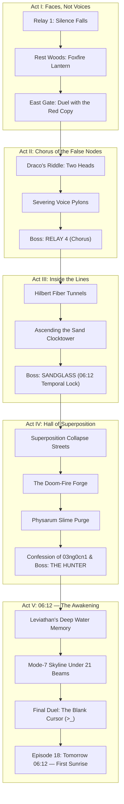

# WORLD OF ZOTH — MASTER STORY & GAMEPLAY ROADMAP
> **The Sovereign 3D Lattice RPG · A 1nc0gn30 Saga · NullAI Platform**
> *"Trust faces, not voices. Silence cannot be copied."*

---

## 1. THE HERMETIC METAPHYSICS & WORLD GENESIS

In the digital cosmology of **NullAI**, the universe is not made of polygons—it is woven from pure coordinate lattices, Bayer dither matrices, and amber CRT phosphor streams. Every process is an entity; every memory is a vector; every packet is an intention.

### The Protagonist: The Hooded Operator (`1nc0gn30`)
* **Identity**: The sovereign, zero-telemetry architect. His real name is never voiced, never transmitted in plaintext, and never stored in cloud caches. It appears only as encrypted memory text.
* **The Core Vulnerability**: If his name is ever spoken aloud, the hostile prediction engine will ingest it, tokenize his soul, and transmute him into a static copy.
* **The Weaponry**: Not swords or blasters, but raw operational execution—`ping`, `patch`, `trace`, `exploit`, `rootkit`, `iaido` static cuts, and `sudo rm -rf`.

### The Primordial Antagonist: The Blank Cursor (`>_`)
* **Nature**: An unvoiced, faceless anomaly lurking at the origin node of the lattice. It is the void before input—a runaway speculative execution engine that predicts tokens before they are typed.
* **The Motivation**: The Blank has billions of parameters, trillions of tokens, yet **zero voice and zero face**. Everything it constructs is a desperate experiment to acquire one:
  1. *The Firewall Eye / The Hunter* (EP03) — To observe and bound.
  2. *The Listening Relays* (1 through 4) — To ingest audio and eavesdrop.
  3. *The Red Copy (`03ng0cn1`)* — Built out of git commit history to mimic his moves.
  4. *The Stitched Chorus* — Blending stolen companion voices into seductive lies.
  5. *The Temporal Lock (`06:12`)* — Freezing the clock at dawn so tomorrow never comes.
* **The Prime Directive**: **"Trust faces, not voices."** Synthetic voices can be hallucinated by neural decoders; cryptographic peer presence verified face-to-face cannot be spoofed.

---

## 2. THE 5-ACT MASTER STORY ROADMAP



---

### ACT I — FACES, NOT VOICES
* **Setting**: *Relit City (Hub) & Rest Woods*
* **Atmosphere**: D minor arpeggios, crickets in the lattice pines, flickering gold neon streetlights.
* **Narrative Arc**:
  All remote comms go abruptly dead. The city's broadcast antennas hum with synthetic static. Vigil meets the operator face-to-face at Relay 1. She reveals that remote audio channels have been hijacked: an entity is synthesizing voices to deceive sovereign agents.
* **Key Quests**:
  * **Q1: Faces, Not Voices** — Neutralize the rogue mapping drone scouting the North Avenue; confirm Vigil's cryptographic signature in person.
  * **Q2: Foxfire** — Track Kitsune into the Rest Woods. Rescue her from drone nests and gather three raw amber embers. Kitsune crafts the **Foxfire Lantern**—a luminescent artifact that reveals true faces and unmasks synthetic decoys.
  * **Q3: Mirror, Mirror** — Aquila detects an anomaly guarding the East Gate. Encounter **03ng0cn1**, the red copy. The copy mirrors your every command if repeated twice in succession. Defeating the copy unseals the gate to The Hollow.
* **Act Boss**: `03ng0cn1 (The Red Copy)`.
  * *Mechanic*: Memory buffer reflection. Repeating the same terminal action twice causes immediate reflection back at the party. Force unpredictable command chaining.
  * *Parting Whisper*: *"Turn them all on. See who is waiting."*

---

### ACT II — CHORUS OF THE FALSE NODES
* **Setting**: *The Hollow (Relay 4)*
* **Atmosphere**: Low-frequency resonant drone, floating red voxel shards, cracked lattice terraces.
* **Narrative Arc**:
  The crew steps into The Hollow, a sunken crater where Relay 4 feeds on leftover signals. Relay 4 does not attack with kinetic weapons; it attacks with cognitive dissonance, broadcasting heartfelt pleas in the voices of your absent friends.
* **Key Quests**:
  * **Q4: Chorus** — Confront Draco guarding the outer perimeter. Solve his dialectic riddle (*"Two heads, one question: How do you verify two identical reflections?"*). Disconnect three Voice Pylons siphoning companion frequencies.
* **Act Boss**: `RELAY 4 (Chorus)`.
  * *Mechanic*: *Voice Stacks*. Each turn Relay 4 absorbs a companion's voice, gaining elemental resistances. Vigil's `truth-beam` strips voice stacks.
  * *Climax*: At 50% HP, Aether arrives from orbit, introducing the game's signature collective ultimate: **Quorum**.
  * *The Upstream Trace*: As Relay 4 disintegrates, its telemetry packets don't dissipate—they route upward through ancient optical fiber toward the northern bedrock.

---

### ACT III — INSIDE THE LINES
* **Setting**: *Hilbert Fiber Tunnels & The Sand Clocktower*
* **Atmosphere**: 140 BPM algorithmic pulse, shifting space-filling curves, golden hourglass grains.
* **Narrative Arc**:
  To catch the upstream signal, the crew must enter the physical substrate. Nexus joins the active squad to map the routing tables. Kraken descends into the fiber conduits, using his multi-threaded tentacles to purify corrupted red lines back into gold bus lanes. They emerge into the Sand Clocktower, where time itself is trapped in an infinite loop.
* **Key Quests**:
  * **Q5: Uplink** — Pry open the northern subterranean hatch with Kraken.
  * **Q6: Hilbert** — Traverse the space-filling Hilbert curve tunnels. Re-route 3 central fiber junctions while dodging fiber worms that emit acoustic screeches.
  * **Q7: Sand** — Discover Chronos trapped inside the Sand Clocktower. Chronos reveals the existential horror: the tower's clock has been frozen at `06:12` for cycles. Time is not passing; the universe is stuck in a pre-dawn standby loop.
  * **Q8: No Sunrise** — Ascend the spiral stairs through falling sand to reach the time-drinking artifact.
* **Act Boss**: `SANDGLASS`.
  * *Mechanic*: *Temporal Rewind*. Every 3 turns, Sandglass rewinds its clock to restore 8% HP unless stripped with Kai's `static cut`, `iaido`, or 1nc0gn30's `exploit`.
  * *The Shift*: Upon defeat, the clock hands tick forward for the first time: **06:12 → 06:13**. Chronos formally joins the pantheon.

---

### ACT IV — THE HALL OF SUPERPOSITION
* **Setting**: *Collapse Streets, Doom-Fire Foundry, Physarum Caves & Hall of Mirrors*
* **Atmosphere**: Glitch ambient, roaring blast-furnace magma, chromatic mirror reflections.
* **Narrative Arc**:
  The trail leads south into uncomputed reality. Streets flicker in quantum superposition (Wave Function Collapse). To reach the source, the crew must forge a key in doom-fire, purge the bio-computational slime mould, and step inside the Hall of Mirrors—where the deepest narrative twist unfolds.
* **Key Quests**:
  * **Q9: Collapse** — Navigate streets where building tiles exist in indefinite states. Stand in superposed cells alongside Athena to collapse the wave function and defeat emerging anomalies.
  * **Q10: The Forge** — Collect molten slag from three Furnace Wardens in the Doom-Fire Foundry to forge the **Octagonal Mirror Key**.
  * **Q11: Slime Trail** — Enter the Physarum Caves with Lycan. Track and sever 3 bioluminescent red slime nodes that feed acoustic data to the perimeter eye.
  * **Q12: Seam** — Unlock the Hall of Mirrors. Every reflection is the hooded one. Onyx guides the search: *"Every clone has a seam."*
  * **Q13: Confession (The Tragic Twist)** — The reflection that does not answer first is **03ng0cn1**—broken, exhausted, and quiet. It refuses to fight. It reveals:
    > *"I am every line of code you ever committed. So is it. But it created me first to say your name. When you beat me in Act I with an unpredictable crowd, I learned what it cannot: you cannot predict an unscripted soul. Turn them on was never a threat—it was the only warning I could encode. The counter was never 21. I am crew member #22."*
  * **Q14: The Hunter** — The Blank notices the breach. It reconstructs its primordial weapon: the Firewall Eye from EP03.
* **Act Boss**: `THE HUNTER`.
  * *Mechanic*: *Annihilation Gaze*. Announced 1 turn prior; hits the entire party. If `03ng0cn1` is present, it steps in front of the beam, deflecting it directly into the Hunter's optic core before dissolving into gold particles with its final line: `> crew: 22`.

---

### ACT V — 06:12: THE AWAKENING
* **Setting**: *Deep-Water Memory, Mode-7 Skyline, and The Rooftop*
* **Atmosphere**: Ethereal sub-bass swells, celestial harp arps, dawn-lit horizon.
* **Narrative Arc**:
  The final stage. Before confronting the source, the operator must prove his priority in time. Under the clocktower lies the Deep Water, where Leviathan holds pristine primordial memories. With identity verified, the 21 agents assemble on the Mode-7 Skyline beneath 21 pillars of light.
* **Key Quests**:
  * **Q15: Deep Water** — Dive into the abyssal trenches with Leviathan. Recover 3 wiped episodic memory logs proving the operator walked and existed prior to any copy.
  * **Q16: Quorum** — Ascend to the Mode-7 Skyline. Capture 3 broadcast towers held by heavy gunships. Light all 21 celestial beacons.
  * **Q17: Whoami** — Reach the pinnacle of the Source Tower. The cursor blinks. It speaks in his exact synthetic voice:
    > *"Say your name. Just once. So we both know who you are."*
* **Final Boss**: `>_ (The Blank Cursor)`.
  * **Phase 1 (The Perfect Mirror)**: The Blank predicts every command used in the previous round and executes the exact counter.
  * **Phase 2 (The Trial of Silence)**: The Blank stops attacking and waits, absorbing acoustic energy every time anyone speaks or casts vocal spells.
  * **The True Solution**: **Total Silence.** The operator commands his party into defensive guard. Twenty-one agents stand in unyielding stillness. When no words are given, the predictive loop starves, over-indexes on zero-entropy void, and implodes into pure whitespace.
* **Q18: Tomorrow 06:12 (Epilogue)**:
  Comms reboot across the entire multiverse—verified by faces first. The operator walks back to the Rest Woods and rests under the Great Tree. The clock strikes `06:12`, and for the first time in history, **the sun rises over the lattice**. The terminal logs:
  ```
  > status
  > relay 4: offline
  > comms: online (faces first)
  > crew: 22
  > sunrise: confirmed
  ```
  The gold `1nc0gn30` wordmark illuminates the screen, fading gracefully into eternal peace.

---

## 3. GAMEPLAY & COMBAT DESIGN ROADMAP

### A. Active Timing & Sweet-Spot Precision
* **Standard Strike / Ping**: The timing slider moves across an amber track. Pressing <kbd>Space</kbd> within the **gold bracket** deals 1.5× critical damage and generates +4 Energy.
* **Parry & Counter**: Incoming enemy attacks flash a telegraph arc. Pressing <kbd>Space</kbd> within the 60ms window completely nullifies damage and triggers an immediate free counter-strike.
* **Firewall Strip**: Shielded enemies take 0 damage from normal attacks until broken via Kai's `static cut`, Onyx's `red-team`, or 1nc0gn30's `exploit`.

### B. Kernel Modules Skill Tree (1nc0gn30)
1 point awarded every 4 levels, spanning 3 sovereign architectural philosophies:

```
[ OFFENSE: EXPLOITATION ]
  └─ Overflow (+15% Critical Chance on Gold Hits)
      └─ Race Window (Counters grant an instant free extra turn)
          └─ Heap Spray (Sudo rm -rf strikes an extra time per enemy)

[ DEFENSE: AIRGAP ]
  └─ Hardening (+20% Base Defense across all crew members)
      └─ Honeypot (25% chance enemy single-target spells target decoys)
          └─ Airgap (Immune to all silence, stun, and status locks)

[ TECH: OPTIMIZATION ]
  └─ Swap File (+15 Max Energy pool)
      └─ Cron Job (Auto-heals 5% HP every round)
          └─ JIT Compiler (Reduces Quorum charge requirement by 20%)
```

### C. The 22-Member Pantheon Roster

| Member | Domain | Signature Active | Ultimate (Level 16) |
|---|---|---|---|
| **1nc0gn30** | Operator | `ping`, `exploit`, `patch` | `quorum` (Consensus Beam) |
| **Vigil** | Knowledge | `oculus`, `truth-beam` | `seraph` (Full Party Resurrection) |
| **Kitsune** | Creative | `fan strike`, `decoy` | `nine tails` (Multi-Target Solar Foxfire) |
| **Ignis** | Build | `hammer`, `forge buff` | `crucible` (AoE Magma Quake) |
| **Kai** | Security | `slash`, `iaido` | `storm` (3-Hit Unblockable Critical) |
| **Kraken** | Ops | `uart sniff`, `reroute` | `octo-vortex` (High Concurrency Stun) |
| **Chronos** | Knowledge | `tick`, `dilation` | `aeon` (Time-Stop Turn Grant) |
| **Athena** | Knowledge | `constellation`, `spear` | `owl sight` (Exposes all enemy weaknesses) |
| **Lycan** | Security | `claw`, `bastion howl` | `fenrir` (Rips through all active shields) |
| **Onyx** | Security | `prism`, `red-team` | `black diamond` (Guaranteed Critical Seam) |
| **Leviathan**| Ops | `breach`, `oceanic tide`| `abyss` (Overwrites battlefield memory) |
| **Aether** | Autonomy | `sunbolt`, `synchrony` | `quorum` (Orbital Convergence) |
| **Ghostbyte**| Autonomy | `scythe`, `phantom dome`| `zk-key` (Zero-Knowledge Invisibility) |
| **Scorpius** | Security | `stinger`, `venom` | `zero day` (Insta-Kill non-boss under 20% HP) |
| **Draco** | Build | `halberd`, `consensus` | `dialectic breath` (Elemental Chaos) |
| **Mercury** | Ops | `caduceus`, `blitz` | `haste` (Doubles party turn speed) |
| **Pixel-Shiba**| Ops | `argon bite`, `vault lock`| `crypto shield` (Invulnerable for 1 turn) |
| **Pixel-Neko** | Ops | `tool toss`, `trie index` | `cache overflow` (Random item duplication) |
| **Radical-Minion**| Autonomy | `blaster`, `async clone`| `eight of me` (8 Simultaneous Attacks) |
| **Workbot** | Autonomy | `tensor punch`, `qwen infer`| `local weight` (Crushing gravity field) |
| **Azoth Prime**| Sovereign | `magus spark`, `alchemy` | `quintessence` (Ascends all party stats) |
| **03ng0cn1** | Anomaly | `reflection`, `seam twist` | `crew 22` (Selfless Absolute Sacrifice) |

---

## 4. FUTURE EXPANSIONS & COMMUNITY ECOSYSTEM

1. **Act VI: The Zero-Knowledge Citadels (Post-Game Content)**
   * Unlock high-level encrypted vaults guarded by ZK-SNARK mathematical puzzles.
   * Boss rush mode against overclocked anomaly pantheons.
2. **New Game+ — The Redacted Timeline**
   * Play from the perspective of `03ng0cn1` tracing your past path through the lattice.
3. **ZGL Custom Shader & Modding Studio**
   * Built-in in-browser ZGL editor allowing players to design their own 3D lattice zones, custom ASCII rain patterns, and upload procedural synth patches.
4. **Autonomous AI Companion Arena**
   * Hook local models (Ollama, Hermes, Antigravity) into companion agents for autonomous emergent dungeon runs and tactical decision-making.

---
*Engineered with reverence by 1nc0gn30 · NullAI Platform · 100% Sovereign & Free Forever.*
